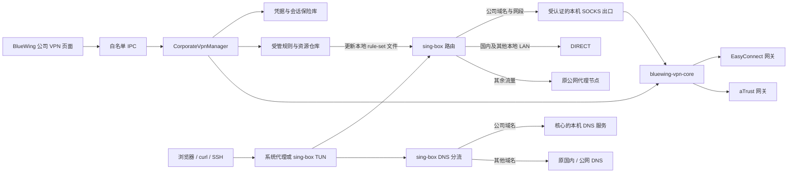
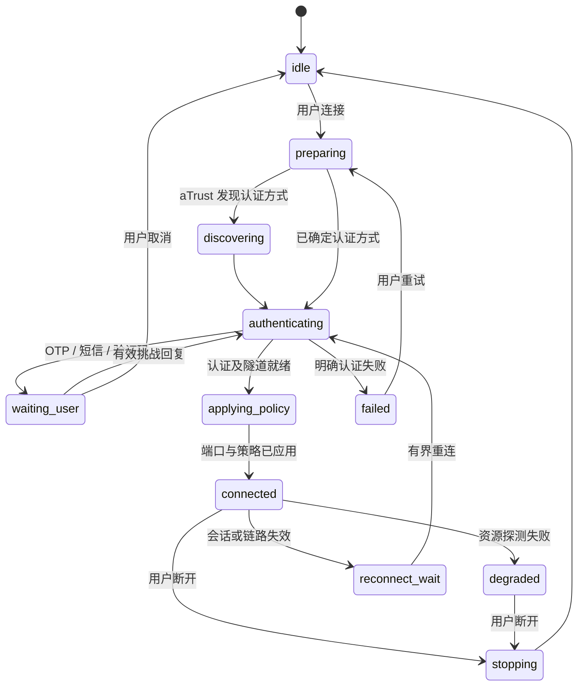

# BlueWing 内置 EasyConnect / aTrust：详细设计

版本：1.0；日期：2026-10-23；状态：待实施设计，不表示相关功能已经实现。

仓库基线：`88226cb`。配套阅读：[实施计划与 GLM 指令](corporate-vpn-implementation-plan.md)、[测试与验收](corporate-vpn-test-plan.md)。本文中的源码路径均相对仓库根目录。

## 1. 要交付的产品

用户只打开 BlueWing：在“公司 VPN”页选择 EasyConnect 或 aTrust，完成认证；BlueWing 自动管理公司隧道、公司域名解析和分流。公司资源走相应隧道，国内域名和国内 IP 保持直连，其余流量继续使用原公网代理。用户不再另外打开 EZ4Connect，不再手工增加本地 SOCKS 节点、导入备份或运行修正规则脚本。

集成方式是一个桌面界面管理 sing-box 和一个企业 VPN 协议核心。两个后台进程属于正常架构；不引入虚拟机、Docker、官方 EasyConnect 驱动或修改其过滤规则。

**最终验收包含 TUN 下不单独配置代理的 curl、SSH 和浏览器。仅完成系统代理下的浏览器访问，只算第一阶段可用，不算全部完成。**

### 1.1 必须满足的约束

| 编号 | 要求 |
|---|---|
| R01 | 同一版本支持 EasyConnect、aTrust 两种配置和真实认证流程 |
| R02 | 原公网节点和 `activeNodeId` 不被公司连接替换；GPT/Codex 继续使用原出口 |
| R03 | 公司规则优先于国内域名、国内 IP、普通私网直连及浏览器进程代理规则 |
| R04 | 两条国内直连保持可用，不要求关闭它们来修复公司访问 |
| R05 | 公司 DNS、公司固定 Hosts、公网 DNS 分离，不修改 Windows 全局 hosts |
| R06 | 公司核心退出、认证过期时，公司目标明确失败，不回落公网或物理直连 |
| R07 | 正常连接、断开、重认证、资源刷新不重启 sing-box，不中断原公网长连接 |
| R08 | 系统代理只有 BlueWing 负责；企业协议核心不设置系统代理、不创建自己的 TUN |
| R09 | 密码、动态码、设备会话不出现在进程参数、普通日志、备份和渲染层查询结果中 |
| R10 | 普通代理模式无需管理员；TUN 使用既有提权机制，权限不足必须如实显示 |
| R11 | 导入、升级、重启、睡眠恢复后，保存配置、运行配置和界面状态一致 |
| R12 | 从日志和诊断页面能区分认证、端口、DNS、分流、隧道和目标服务失败 |

### 1.2 首版范围与后续范围

首版支持保存多个公司配置、选择其中一个连接；EasyConnect 和 aTrust 均属于首版范围。暂不承诺两个公司隧道同时在线。数据结构保留多实例能力，但多公司同时在线和地址冲突仲裁另列迭代。

首版交付阶段：

1. **M1 代理接入**：集成登录、资源、DNS、HTTP/SSH TCP、生命周期、故障隔离。
2. **M2 全应用接入**：由 BlueWing 的 sing-box TUN 接管，不逐个应用配置代理；完成两协议的 TUN、DNS、防回环和恢复验收。
3. **M3 扩展认证**：按网关实际能力交付 CAS 等浏览器认证；未知方式显示“不支持”，不得假装成功。

“全应用”指通过TUN统一接管，不能理解成兼容任意网络协议。HTTP、HTTPS、SSH等TCP办公业务是必验；UDP需要实现能力声明、支持路径测试和不支持时明确拒绝，不能静默DIRECT。普通ping的ICMP不作为本机SOCKS出口能力承诺。

发布说明必须分别列出“EasyConnect 已实测的认证方式”和“aTrust 已实测的认证方式”。没有 aTrust 实机网关时，可以完成开发和模拟测试，不能标为 aTrust 实机验收通过。

## 2. 现有代码与此次故障给出的约束

| 现有模块 | 已有能力 / 接入影响 |
|---|---|
| `src/main/core/ConfigGenerator.ts` | 生成 sing-box 入站、节点、DNS、规则；需接入企业运行上下文和固定优先层 |
| `src/main/core/SingBoxManager.ts` | 进程、配置检查、启动互斥、端口就绪；其 `start()` 会停止旧核心，不能用于每次公司连接 |
| `src/main/core/ProxySelectionService.ts` | 公网 selector 和数据库选择同步；公司配置不能进入公网节点选择流程 |
| `src/main/index.ts` | IPC、核心启动、退出、提权、导入后广播；需要串行化企业连接和运行配置应用 |
| `src/preload/index.ts` | contextBridge 白名单；新增企业 API，不开放任意命令或通用 IPC |
| `src/main/db/Database.ts` | 主数据库 v2、原子落盘、节点与规则；节点整体序列化，不能假定所有节点凭据都已加密 |
| `src/main/security/CredentialSecurity.ts` | DPAPI/safeStorage；当前存在 Base64 降级和解密失败空串路径，不能原样作为新 VPN 保险库 |
| `src/main/system/SystemProxy.ts` | 代理所有权及恢复；还需连接级 WinINet 同步修复 |
| `src/main/system/TakeoverLinkage.ts` | TUN 与系统代理互斥；企业连接不能绕过或反向重置这些用户选择 |
| `src/main/db/backup/*` | 分类导入、预览、合并与替换；需把企业配置及 DNS 纳入一致性设计 |
| `src/renderer/pages/Routing.tsx` | 已提交置顶、上移、下移；新受管企业规则应有独立、固定优先的展示区 |
| `src/renderer/components/Sidebar.tsx`、`src/renderer/App.tsx` | 增加“公司 VPN”入口及状态订阅 |

已定位的真实故障应成为回归用例：

- 官方客户端可能限制公网和本地 LAN。此方案复用已验证可连接的协议实现，不对官方客户端进程、驱动或过滤器做修改。
- 将公司 SOCKS 节点选为公网主节点会导致公网不可用。因此受管企业出口不出现在“设为公网主节点”的候选项里。
- 国内规则抢先命中公司域名，会绕过公司代理。公司规则必须由编译器保证顺序，不能依赖用户拖动和备份合并。
- 注册表中的代理绕过项正确，不代表 WinINet 连接级代理正确。曾出现浏览器仍绕过代理直连私网。
- `ping` 是 ICMP；普通 curl 不一定读取 Windows 系统代理。它们不是 SOCKS/HTTP 模式的默认验收手段。
- 后端停止而前台窗口仍在时，本机 SOCKS 端口可能已经消失。界面进程存在不等于隧道可用。
- `runBackupImport()` 当前只在公网活跃节点变化时走切换同步，不能据此保证规则/DNS已经应用；合并模式也不改变已有同名规则位置。
- Windows 备份解析当前没有把 `decoded.dns` 传入解析结果，虽然后续事务支持 DNS。迁移与备份阶段必须补齐测试。

以上是代码检查和本次排查证据，不代表本文提出的改造已经完成。

## 3. 技术选型与上游能力

### 3.1 推荐复用 zju-connect，新增结构化桥接层

EZ4Connect 的图形界面负责配置、启动和认证交互；实际隧道能力来自 zju-connect。上游已提供 `easyconnect`、`atrust` 协议入口及 SOCKS/HTTP 服务。BlueWing 继续使用自己的 Electron/React 界面，由主进程管理协议核心。[S1][S2]

推荐产物名：`bluewing-vpn-core.exe`。基于固定版本的 zju-connect 维护小型 fork，增加结构化控制模式、认证回调、资源导出、严格隧道拨号、受控会话存储和证书配置。保留上游版权和许可证。

不要从头实现深信服协议，不复制 EZ4Connect 的 Qt 界面，不把现有 CLI 文本日志解析器当作正式控制接口。可以用原始 CLI 做 P0 兼容性验证；正式版本需要下面定义的机器协议。

**本文的 JSON 控制命令、事件和模块名是拟新增接口，不是 zju-connect 当前已经提供的 API。** 上游导出的客户端能力可用于实现，具体 Go 函数签名由 GLM 对固定提交源码核实。

### 3.2 版本基线

| 组件 | 设计基线 | 开发要求 |
|---|---|---|
| BlueWing | `88226cb`，package 版本 1.0.0 | 保留现有行为与测试 |
| sing-box | 本机已验证 1.14.3 | 用实际打包二进制校验，不套用其他版本字段 |
| zju-connect | 当前已验证使用 v1.3.1 | P0 固定 tag 对应 commit SHA、源码和构建哈希 |
| EZ4Connect | 本次参考 1.9.1 | 只作为功能和兼容性参考 |
| Go | v1.3.1 的 `go.mod` 声明 1.25.6 | 固定工具链；先检查选定 commit，不直接依赖 latest |
| Electron/React/TS | 以 package-lock 为准 | 不为接入顺便升级前端框架 |

版本信息来自本机项目和上游固定版本文件；不是对未来最新版的推荐。[S3]

### 3.3 许可证交付门槛

核对到 zju-connect 为 AGPL-3.0，EZ4Connect 仓库标识 GPL-3.0；当前 BlueWing 声明 `UNLICENSED`。[S4][S5]

P0 要记录复用方式、fork 修改、构建脚本、对应源码与许可证材料的交付办法。**不能因为分成两个 exe，就断言整个集成产品一定不受相关义务影响。** 对分发方式和组合关系作明确确认后再发布安装包；实现文档不擅自替产品选择许可证。不要复制 EZ4Connect 代码来逃避这一项检查。

## 4. 总体架构



### 4.1 进程与所有权

- Electron 主进程是配置、连接意图及运行代次的唯一事实源。
- sing-box 是唯一的系统接管者。企业核心禁用自己的 TUN、系统代理及系统路由添加功能。
- 企业核心通过继承的 stdin/stdout 管道接受命令；stdout 专用于结构化消息，stderr 是经过脱敏的诊断日志。
- 每个配置有固定的逻辑出口 tag 和本机端口租约。首版只有一个企业隧道在线；不同配置预留不同端口，离线配置仍保留拦截路由。
- 公网 selector 只包含普通公网节点。企业出口是 `managed: true` 的内部出口，不是用户可以双击切成主节点的 SOCKS 节点。
- 主程序退出时停止自己拥有的企业核心；不能按进程名批量杀死外部 EZ4Connect 或其他客户端。

一个企业核心进程可以托管多个配置的本地端点，但首版只允许其中一个VPN会话在线。端口由核心直接绑定并确认所有权；不要仅“检测空闲后关闭探测socket”就认为端口已保留。遇到外部EZ4Connect占用11080时分配并持久化新的租约，不接管或误认外部服务。

### 4.2 为什么需要固定出口与本地规则集

sing-box 1.14.3 的 Clash `PUT /configs` 处理函数只返回成功响应，没有执行全量配置重载。不能把 HTTP 204 当作配置已应用。[S6]

该版本支持本地 rule-set 文件变动后的重载。设计利用固定出站 + 本地公司规则集，避免每次连接都调用 `SingBoxManager.start()`。[S7][S8]

需要区分：

| 操作 | 应用方式 |
|---|---|
| 已注册配置的连接、断开、OTP、认证恢复 | 企业核心内部切换，不重启 sing-box |
| 公司资源、手工域名/CIDR 更新 | 校验后更新受管本地 rule-set；验证目标核心确实重载 |
| 公司 Hosts 与 DNS 返回变化 | 更新核心内部解析策略；固定 DNS 服务地址不变 |
| 首次注册新配置、端口变更、改变 TUN 接管模式 | 可能需要重建 sing-box 顶层配置；在设置应用时明确安排一次重连 |
| 删除企业配置 | 先停会话并处理遗留目标保护；再执行显式配置应用 |

首次设置引起的重连不能伪装成无中断；日常连接/断开不能因此不断重启公网核心。

## 5. 认证能力矩阵

| 能力 | EasyConnect | aTrust | 首版处理 |
|---|---|---|---|
| 账号密码 | 上游具备 | 上游具备 | 两协议必须实测 |
| 手工 TOTP 动态码 | 本机已验证 | 上游 Setup 接收 TOTP 配置，具体挑战取决于网关 | 通用挑战模型；按网关返回启用 |
| 图片/图形验证码 | 上游具备 | 上游具备，可能是不同的结构化载荷 | 必须保留 provider 差异，不能都当成一个文本数字框 |
| 认证方式发现 | 不强制套用 aTrust 接口 | `-auth-info` 可发现 loginDomain/authType/authName/loginUrl | aTrust 设置页必须有“获取认证方式” |
| 登录域 | 协议特有配置另核实 | 必须与发现结果匹配 | 不写死 `Radius`、`local` 或学校默认值 |
| 短信认证 | 不推定所有网关支持 | 上游列出 `auth/smsCheckCode` | aTrust 首版实现发送、倒计时、重发、验证和取消 |
| CAS | 不推定支持 | 上游列出 `auth/cas` | M3；能力声明与真实回调验证后开放 |
| OAuth2 参数 | 不推定支持 | 上游有 code 配置入口 | 不等于已兼容所有 OAuth/OIDC/SSO 服务；逐一验证 |
| 证书登录 | 上游有 p12 配置 | 不由 EasyConnect 能力类推 | EasyConnect 扩展项，安排独立测试 |
| 保存设备/登录状态 | 不保存原始 token 到普通配置 | ClientData/SID/DeviceID/SignKey 等需保护 | 默认不记住；选择记住后仅加密存储 |

认证方式清单依据固定版本 README、配置和代码；服务端可用项由实际发现结果决定。[S1][S9][S10]

### 5.1 通用挑战模型

拟新增 `AuthChallenge`：

```ts
type VpnProtocol = 'easyconnect' | 'atrust';
type ChallengeKind = 'otp' | 'sms' | 'image' | 'browser' | 'structured';
interface AuthChallenge {
  challengeId: string;
  profileId: string;
  generation: number;
  kind: ChallengeKind;
  expiresAt: number;
  title: string;
  fields: Array<{ name: string; secret: boolean; format?: string }>;
  image?: { mime: string; bytesBase64: string };
  browser?: { requestId: string; allowedOrigin: string };
}
```

- 不把六位动态码填进 TOTP 种子字段。首版以手工 OTP 为默认，种子自动生成是后续选项。
- 挑战只能消费一次，绑定连接代次；连接已取消、已过期或属于旧代次的回复必须拒绝。
- 图片直接以受限大小字节展示，或使用当前进程私有临时目录；不接受渲染层指定任意本机路径。
- 短信发送和重发均为用户明确动作，展示服务端冷却时间；不由自动重连反复发送短信。
- aTrust 浏览器验证使用系统浏览器和受控回调流程；需要时校验 state、回调来源及 PKCE。不得抓取浏览器密码、绕过证书警告或把任意 loginUrl 直接变成主进程网络权限。
- `auth/psw`、`auth/smsCheckCode`、`auth/cas` 等标识保留原值；UI 文案可以翻译，不改协议值。

认证方式发现属于网络请求，也需要超时、TLS校验和取消。发现结果按网关与协议绑定，不能拿EasyConnect的TOTP页面去代替aTrust认证方式选择。

## 6. 数据与模块设计

### 6.1 配置、机密、运行态分开

采用独立的 `vpn-profiles.json`（schemaVersion 1）与受保护保险库，不把企业密码再塞进普通 `ProxyNode`。主数据库 v2 保持兼容；配置仓库统一使用 `Database.getDataDir()` 决定的位置，不能自行拼接另一个 APPDATA 或安装目录。

```ts
interface CorporateVpnProfile {
  id: string;
  name: string;
  protocol: VpnProtocol;
  gateway: { host: string; port: number };
  auth: {
    method?: string;
    loginDomain?: string;
    usernameHint?: string;
    rememberPassword: boolean;
    rememberSession: boolean;
    credentialRef?: string;
  };
  tls: { mode: 'system' | 'custom-ca' | 'pinned'; caRef?: string; pinSha256?: string };
  targets: Array<{
    id: string;
    match: { domains?: string[]; cidrs?: string[]; ports?: string[]; network?: 'tcp' | 'udp' };
    source: 'manual';
    probe?: { kind: 'tcp' | 'http' | 'ssh'; port: number; path?: string };
  }>;
  hosts: Array<{ domain: string; addresses: string[] }>;
  dns: { mode: 'server-auto' | 'custom'; servers?: string[]; fallback: 'corporate-only' };
  runtimeLease: { socksPort: number; dnsTcpPort: number };
  reconnect: { enabled: boolean; maxAttempts: number };
  updatedAt: number;
}
```

`credentialRef` 仅指向主进程保险库。密码、OTP、种子、会话、SOCKS 内部密码不是上述对象的一部分。渲染层得到 `hasPassword/hasSession`，得不到密文或解密内容。

服务端资源保存为独立 `ResourceSnapshot`：包含 profileId、协议、网关指纹、获取时间、revision/hash、domain/IP 区间、端口、网络协议及 DNS 数据。明确标注“服务端下发 / 用户手工 / 上次缓存”，不把缓存展示为本次新授权。

范围资源先保留 start/end，再精确拆 CIDR；不能向上扩大成 `/16` 或 `10.0.0.0/8`。受撤销资源从可用集合移除，可保留隔离记录阻止它落入公网；隔离记录不是访问授权。

### 6.2 拟新增文件

| 路径 | 职责 |
|---|---|
| `src/types/corporateVpn.ts` | 配置、状态、挑战、资源、IPC DTO、诊断和错误定义 |
| `src/main/vpn/CorporateVpnManager.ts` | 用户意图、连接代次、状态机、取消和重连策略 |
| `src/main/vpn/VpnCoreProcess.ts` | spawn、JSON 帧、超时、限流、退出、进程归属 |
| `src/main/vpn/VpnProfileRepository.ts` | 非机密配置、端口租约、原子保存、版本迁移 |
| `src/main/vpn/VpnCredentialVault.ts` | DPAPI、会话加密、引用删除、锁定状态 |
| `src/main/vpn/VpnResourceRepository.ts` | 规范化、来源和资源快照；拒绝未知格式的静默扩权 |
| `src/main/vpn/VpnPolicyCompiler.ts` | 编译受管 route/DNS rule-set；固定优先层 |
| `src/main/vpn/VpnPolicyPublisher.ts` | 文件校验、更新、回退、revision 和实际应用证据 |
| `src/main/vpn/VpnDiagnostics.ts` | 从指定出口探测资源；给出失败层级 |
| `src/main/vpn/VpnIpc.ts` | 输入校验、sender 校验和白名单处理 |
| `src/renderer/pages/CorporateVpn.tsx` | 两协议配置、连接、资源和诊断页 |
| `src/renderer/components/VpnAuthDialog.tsx` | 通用挑战 UI 与 provider 特有字段 |
| `vpn-core/` 或单独 fork 仓库 | Go 桥接层、核心源码及构建；P0 决定具体组织方式 |
| `scripts/build-vpn-core.*` | 固定工具链/提交构建，输出版本、哈希和许可证清单 |

这些是拟建路径；不要求为了文件数拆分简单函数，但不能把认证与进程代码全部堆进 `index.ts`。

## 7. 核心控制协议

### 7.1 传输与帧

建议命令行只传 `--control=stdio-json --protocol-version=1` 等非机密开关。父子通过继承管道传输 UTF-8 NDJSON。stdout 不混入普通上游日志；跨 chunk 使用增量 UTF-8 decoder，不假设一次 data 事件就是一行。

每帧包含 `version`、`kind`、`requestId`、`profileId`、`generation`、`type`、`payload`；事件增加单调 `seq`。普通帧上限 1 MiB；资源快照按 chunk 分页，总上限和条数由能力协商限制（建议 8 MiB、50000 项），超限失败，不静默截断。图片另限 1 MiB。未知版本、非法 JSON、重复响应和超长行进入明确错误路径。

```json
{"version":1,"kind":"command","requestId":"r1","profileId":"p1","generation":7,"type":"connect","payload":{"protocol":"atrust","gateway":{"host":"vpn.corp.example","port":443},"authMethod":"auth/psw","loginDomain":"discovered-domain"}}
```

实际密码由同一受控管道中的机密 payload 传递；上述示例特意省略，不是把密码留在其他 CLI 参数或普通临时文件里。

| 命令 | 行为 |
|---|---|
| `hello` | 返回协议、构建、上游 commit、能力和上限；不自动登录 |
| `discoverAuth` | aTrust 获取方式与登录域；EasyConnect 返回其支持能力/明确 unsupported |
| `prepareEndpoints` | 绑定精确 loopback 端口，启用内部 SOCKS 身份认证；绑定失败不得发 ready |
| `connect` | 开始一次认证，接受临时凭据和可选加密会话解封后的内存数据 |
| `answerChallenge` / `cancel` | 只作用于指定 generation/challengeId |
| `updatePolicy` | 原子切换目标、Hosts 与 DNS 策略；带期望 revision |
| `probe` | 经本实例指定隧道/DNS探测，不使用系统默认代理；只探测配置内目标 |
| `disconnect` | 停止会话、关闭已有公司连接、保持离线拒绝的本地服务 |
| `shutdown` | 有界清理资源，结束子进程；stdin EOF 同样触发 |

事件至少包含 `authMethods`、`challenge`、`authenticated`、`resources`、`endpointsReady`、`tunnelReady`、`health`、`sessionUpdated`、`error`、`stopped`。`sessionUpdated` 为机密事件，只到主进程保险库，不转发普通 renderer 事件总线。

### 7.2 对上游的必要改造

1. 登录输入改为可取消 AuthProvider 回调；CLI 原行为保留为另一适配器。
2. 两协议导出规范化资源、DNS、认证能力；保留端口、协议及 IP 区间。
3. 增加 **tunnel-only** 拨号路径。本地公司 SOCKS 请求不能因“资源没匹配 / DNS 失败”转用 upstream DIRECT。
4. 增加长期存在的本地 SOCKS 与 DNS 服务，离线返回不可达/SERVFAIL；会话连接失败不等于整个服务进程必须退出。
5. 处理取消、超时、父进程 EOF、socket关闭；禁止 os.Exit/log.Fatal 直接绕过桥接清理和最后状态事件。
6. aTrust ClientData 从内存导入、通过机密事件导出；不固定写一个明文 `client_data.json`。
7. 对登录、探测、隧道链路统一注入 TLS 策略。上游 EasyConnect 客户端存在默认跳过证书验证的路径，不能原样当产品默认安全策略。[S11]
8. 认证失败、资源刷新失败、线路切换失败各有错误码；禁止输出 token、SID、TWFID、SignKey、TLS key log。

## 8. 生命周期与“已连接”语义



`connected` 的必要条件：当前代次认证成功、隧道就绪、预期本地端口由本进程持有、内部 SOCKS 认证握手成功、公司策略 revision 已应用。资源探测是独立状态；不要因为某个生产站点 403/超时，就宣告整个隧道认证失败，也不要因为 TCP 监听成功就宣告所有资源可用。

超时建议：核心 hello 5 秒、网络连接 10 秒、普通认证网络调用 30 秒；等待用户输入按挑战有效期，默认不超过 120 秒；正常停止 5 秒后只终止本实例的进程树。所有等待可取消。

保活使用服务端支持的会话机制或用户明确配置的公司探测资源；不为保持公司隧道而定时请求硬编码的公网/学校网站。验证码等待时间不计为网络调用卡死。

`desiredConnected` 与 `actualState` 分开。每次用户 connect/disconnect 增加 generation；迟到的 ready、OTP 和资源事件不能恢复旧连接。重连采用 2/5/10/30 秒退避和抖动，建议最多 5 次；密码错误不自动重试，MFA 需求转等待用户，用户断开后清除计时器。

企业核心崩溃后保留路由保护，SOCKS 连接失败不能切到公网。管理器可重启自己的本地服务并恢复会话，复用原端口和本机认证凭据，避免触发 sing-box 重配。

## 9. 路由编译与资源刷新

### 9.1 固定优先层

依次处理：

1. 独立测速入口、协议识别与必要 DNS 接管；避免公司 DNS 服务自身递归。
2. 用户明确的阻止规则/进程阻止及已有广告拦截策略。
3. 企业核心进程和网关底层连接的直连排除，防 TUN 回环。
4. **受管企业目标规则**：服务端资源 + 手工目标 + 需要保护的缓存目标。
5. 其他用户自定义规则。
6. 非企业目标的本地 LAN/私网直连。
7. 国内域名直连、国内 IP 直连。
8. 普通应用 proxy/direct 规则。
9. 原公网默认出口；公网 direct/global 模式只改变非企业部分。

受管企业规则不靠保存为普通数组尾部来生效。编译器显式插入该层；路由页显示“由公司 VPN 管理”，修改目标跳转到公司配置。普通规则排序功能继续保留。

这一层包含“活动公司路由”和其后的“所有已知公司目标保护集合”。保护集合命中但没有可用活动归属时直接reject。切换配置时，inactive配置的活动rule-set置为空，但保留其目标保护；重叠地址交集明确归当前活动配置。先发布保护集合再切换活动集合，保证多个文件更新间只能出现短暂公司不可用，不出现公司目标走公网的窗口。

保护集合按公司域名/地址覆盖所有端口，去掉“允许访问规则”的端口限制；它只负责拒绝回落，不授予访问。否则公司地址上未授权的端口会因没命中允许规则而落到公网。允许集合仍严格保留资源端口和协议。

核心进程直连只用于网关控制链路，不表示允许公司资源从本机物理网络访问。公司 SOCKS 的数据拨号始终使用隧道。

### 9.2 本地规则集布局

为每个已注册配置预先生成固定 route/DNS rule-set 定义及内部 SOCKS 出站。示意：

```json
{
  "route": {
    "rule_set": [{"type":"local","tag":"corp-p1","format":"source","path":"<dataDir>/vpn-runtime/p1/route.json"}],
    "rules": [{"rule_set":["corp-p1"],"action":"route","outbound":"corp-out-p1"}]
  }
}
```

这是片段，不是可直接覆盖用户完整配置的文件。rule-set 内使用兼容的 source schema（简单条件可用 version 3，经 1.14.3 check 验证），示例：

```json
{"version":3,"rules":[{"domain":["dev.corp.example","uat.corp.example"]},{"ip_cidr":["10.20.30.0/24"],"port":[22,80,443],"network":["tcp"]}]}
```

按同一服务端资源的端口/协议分组，避免把多个资源做笛卡尔积扩大权限。当前版本 domain/IP 匹配有其 OR 分组逻辑；有交集需求使用显式 logical `and`，不能把“写进同一对象”一律理解为 AND。[S12]

生产配置还需在所有活动公司route规则之后、普通规则之前，加入 `corp-protected-all` 的 `action: reject`。公司DNS同样有独立保护集合。上述简单片段没有展示它，不得直接当作完整实现。

### 9.3 发布事务

1. 接收完整新 revision，校验格式、地址范围、端口和规模。
2. 在未发布目录生成候选文件，用对应核心进行语法/规则集校验。
3. 企业核心先装载新允许策略或过渡期保护策略，再发布路由/DNS文件。
4. 用经过 P0 验证的 Windows 写入方式触发本地 watcher；记录内容 hash。
5. 验证路由确实使用新规则且 sing-box PID 未变。文件已写入或 Clash 204 都不算应用证据。
6. 成功后更新 appliedRevision 并提交持久快照；失败恢复上个有效文件、标记 degraded，保留原公网配置。

多文件 rename 不是整体原子事务。新增目标先扩大“仅进公司隧道”的保护，再开放访问；删除/撤销先让核心拒绝，再收敛路由。文件观察延迟内宁可公司请求暂时失败，不允许它落到公网。

P0 必须验证本地 rule-set 在 Windows 下新增 CIDR、原子替换、连续更新和损坏文件的行为。若实际版本不能满足 R07，先记录阻塞并调整方案，不得偷偷改成每次企业连接重启公网核心。

### 9.4 冲突处理

公司目标与本地 LAN 重叠时，在配置页显示具体冲突。使用精确域名、主机、端口和用户明确的归属选择；不要默认把所有 `192.168.*` 或 `10.*` 送进公司。相同数字 IP 同时代表两个服务且端口也相同时，仅靠目标地址分流不能同时区分，必须在设计/验收中说明这一边界。

自动保护范围限于服务端已发现和用户已声明的公司目标，软件不能凭空识别所有未知私有域名。新SSO跳转域名必须经资源发现或用户配置后才获得公司归属。

## 10. DNS 设计

### 10.1 两个解析位置都要覆盖

sing-box SOCKS5 出站可以把域名直接交给下游，而不是先使用自身 Hosts 解析。因此只加 BlueWing 的 Hosts，不能保证企业核心使用同一映射。核心必须共享并应用该配置。[S13]

解析优先级：用户指定的公司 Hosts → 服务端资源自带映射 → 服务端公司 DNS → 公司备用 DNS。公司查询不得失败后回落公网 DNS；未知生产内网 IP 不猜测、不固定成当前公共解析结果。

### 10.2 固定公司 DNS 服务

企业核心提供固定 loopback DNS-over-TCP 服务；它在内部经 VPN 完成上游查询，UDP 上游是否可用由核心处理。sing-box 使用 TCP DNS server 指向它，不要求企业 DNS 服务器自身支持 TCP。DNS-over-TCP 的本地监听不带公网开放能力。

DNS规则先匹配公司域名集合，再处理 FakeIP、国内与公网规则。公司集合是独立的只含域名的规则集，不直接复用含端口/IP条件的路由集合。针对公司查询可使用 `disable_cache`，由企业核心统一维护带 revision 的缓存，防止旧公网 NXDOMAIN 和旧会话数据跨连接复用。[S14]

公司 DNS 离线返回 SERVFAIL；不通过公共备用解析器伪造“解析成功”。不能全局禁用 AAAA 来掩盖问题：公司无 IPv6 时明确返回合法的空 AAAA 结果，并测试浏览器的回退行为。

### 10.3 TUN 与应用自己的 DNS

- TUN 接管普通 DNS，保证公司查询先走公司解析；公司域名原则上不发 FakeIP，若使用需证明两核心可一致还原。
- 浏览器自设 DoH、应用固定 DNS 可能绕过系统 DNS。产品要有检测说明；明确不管理的第三方 DoH 不得算已实现全应用解析。
- 不为此解密 HTTPS；通过支持的应用/系统配置或精确域名策略处理。域名已在 HTTP CONNECT 或 SOCKS 请求中时，尽量保留给公司核心解析。
- SSH 的裸 IP 请求不依赖域名，但仍必须命中公司 IP 集合。

M2还必须测试“服务端只下发域名、没有CIDR”的资源以及按域名连接的SSH（没有HTTP Host/TLS SNI）。核对sing-box DNS反向映射与原始域名保留；不能只靠TLS sniff。若需要从公司DNS结果生成精确/32或/128租约，必须按TTL/会话过期回收并处理共享IP冲突；若选择FakeIP方案，则在P0证明两核心能保留/还原原始目标。未通过这一实验不能声称全应用域名资源已经覆盖。

## 11. Windows 接管与公网隔离

### 11.1 系统代理

公司模式启动时所有应用代理请求先进入 BlueWing，其他 LAN 由 sing-box DIRECT，因此不能仍用覆盖所有私网的系统代理绕过项。普通模式保留原语义；开启受管公司分流时，将广泛私网 bypass 作为明确的配置冲突处理。

最小绕过保留 localhost、127/8、必要 IPv6 loopback；`<local>` 会影响单标签内网名，不能无条件保留。用户自定义绕过表也需要检查是否覆盖公司目标。

对 `SystemProxy.ts` 的修复要求：

1. 通过 WinINet per-connection option 查询/设置实际连接级代理，不只读写注册表。
2. 使用 `INTERNET_OPTION_PER_CONNECTION_OPTION`（75）同步相关选项，再发送变更/刷新通知；区分默认 LAN 和实际存在的连接条目。
3. 保存并恢复原 flags、代理、bypass、PAC URL、自动检测等所有权快照；不去修改其他用户账户的 HKCU。
4. 不压平 PowerShell here-string；当前 `.replace(/\r?\n/g, ' ')` 会破坏语法，1200ms 固定超时也可能杀掉 Add-Type。
5. 可以实现为小型原生 helper 或经过正确编码的参数化调用；有超时、错误和回读校验，不直接手改二进制连接缓存。
6. 回读正确后还要用 Edge 与目标请求验证；注册表相同不是唯一验收依据。

WinINet 的设置、错误处理以 Microsoft API 定义为准。[S15]

### 11.2 TUN

只启用 sing-box TUN。企业核心对网关连接绑定当前物理出口，并在 TUN 路由里使用进程/网关排除；清除子进程继承的 HTTP_PROXY、HTTPS_PROXY、ALL_PROXY 等变量，不能从公网代理再绕回自己。

aTrust 可能发现多个服务节点；新底层节点必须先纳入排除再拨号。网卡切换和睡眠恢复重新选择物理出口，不能写死 ifIndex 或本地 Wi-Fi IP。

同时检查Windows最优路由与已有VMware/Hyper-V等虚拟网卡的connected routes：开TUN不自动证明每个企业IP已被捕获。需要精确企业路由时，选用经P0验证的sing-box机制或有明确所有权/恢复记录的路由适配器；不得批量删除用户已有路由，也不能为刷新资源而隐式重启公网核心。

保留 TakeoverLinkage 和已有管理员门禁。企业连接按钮不自动开启 TUN，也不把 TUN 开关置为“开”但实际剥除。只使用系统代理时，普通无参数 curl/SSH 的覆盖范围应如实显示。

## 12. 状态、诊断与错误

UI 分别显示公网核心、企业认证/隧道、规则应用、资源探测四类状态。推荐文案示例：

- “等待动态码”“等待短信验证”“认证成功，正在应用资源”。
- “公司隧道已连接；开发资源可访问；生产资源超时”。
- “公司核心未运行，本机代理端口未监听；公网代理正常”。
- “已保存配置，运行规则尚未更新”。

诊断结果包含 profileId、generation、预期出口、实际出口证据、配置 revision、DNS来源/返回值、TCP/SOCKS/HTTP/SSH阶段、耗时和错误码。诊断请求只允许配置内目标，限制并发和超时，不暴露任意主进程代理请求能力。

| 错误码 | 含义 / 动作 |
|---|---|
| `CORE_MISSING` / `CORE_VERSION_UNSUPPORTED` | 本地组件缺失/不兼容，不能显示已连接 |
| `LOCAL_PORT_IN_USE` / `CORE_ENDPOINT_UNAVAILABLE` | 端口冲突/核心未监听；不接管未知服务 |
| `GATEWAY_UNREACHABLE` / `TLS_UNTRUSTED` | 网关链路或证书错误 |
| `AUTH_METHOD_UNSUPPORTED` / `AUTH_FAILED` | 能力不支持/明确认证失败；不无限重试 |
| `AUTH_CHALLENGE_EXPIRED` / `AUTH_CANCELLED` | 过期/用户取消 |
| `SESSION_EXPIRED` / `VPN_TRANSPORT_DOWN` | 会话/隧道失效，按策略重连 |
| `RESOURCE_SCHEMA_UNSUPPORTED` | 服务端资源无法正确转换，不静默扩大网段 |
| `RESOURCE_DENIED` | 核心得到明确拒绝证据；普通超时不冒充此错误 |
| `CORPORATE_DNS_FAILED` | 公司解析失败，不回落公网 |
| `POLICY_APPLY_FAILED` | 已保存但未确认应用；展示期望/实际版本 |
| `TARGET_TIMEOUT` / `TARGET_HTTP_STATUS` | 指定目标失败，不一律归为 VPN 未连接 |
| `CREDENTIAL_STORE_LOCKED` | 无法解密当前用户机密，不用空密码自动登录 |

HTTP 302 表示到达重定向阶段；验收还应跟随跳转，检查新域名是否也属于公司资源。403 证明收到 HTTP 响应，不代表应用权限正常。SSH 要读协议 banner，不能仅看端口能否建立 TCP。

## 13. 凭据、会话与 TLS

- 新保险库强制 Windows 用户级 DPAPI/safeStorage。运行环境不具备加密能力时，“记住密码/会话”不可用；允许只在内存连接，禁止降级为 Base64 持久化。
- OTP、短信验证码、CAS ticket、OAuth code 一次使用，不落普通磁盘、不进入日志和备份。
- aTrust 的 ClientData、SID、DeviceID、SignKey 和 EasyConnect 的 session/token 视为机密；加密存储按用户/profile/gateway绑定，换服务器不自动复用。
- 不提供 renderer 的 `getPassword/getSession`；禁止把机密放在 `core:getLiveConfig`、通用错误对象和诊断导出中。
- 关闭默认 debug PCAP/TLS key log；日志进入 LogManager 前脱敏，不能只在导出时处理。包括 URL query、headers、stderr和跨 chunk 的机密值。
- SOCKS 只监听 loopback，使用独立内部凭据；其配置文件也按用户限制读取，不能被普通备份导出。避免其他本机服务占据旧端口后接收到公司流量。
- SOCKS账号认证是客户端访问控制，不是对代理服务端的密码学身份验证。端口恢复先核对自有进程和握手；如威胁模型包含恶意本机端口冒充，P0另验证带服务端证书校验的本地TLS CONNECT等传输，不能声称仅加SOCKS密码就已解决服务端冒充。
- TLS 默认优先验证系统信任链；按用户后续要求，首次遇到不受信任的签发者时采用网关级 TOFU 固定指纹，后续严格核对，已记录证书变化必须失败并重新确认。TOFU 首次记录不等同于独立身份验证。过期、尚未生效、可信 CA 降级和显式 CA 错误不自动放行；保留严格模式、自定义 CA 和人工 pin。不得无条件全局跳过校验。具体实现与验收见 `corporate-vpn-implementation-status.md`。
- 父子管道、临时文件、导出的截图和会话清理均限制大小与生命周期。只清理本实例拥有的目录和 PID。

## 14. IPC 与 UI

新增白名单 API（均为拟新增）：

```ts
corporateVpn.listProfiles(): Promise<PublicVpnProfile[]>;
corporateVpn.saveProfile(input: ProfileInput): Promise<SaveResult>;
corporateVpn.deleteProfile(id: string): Promise<void>;
corporateVpn.discoverAuth(id: string): Promise<AuthMethod[]>;
corporateVpn.connect(id: string, transient?: TransientCredentials): Promise<OperationId>;
corporateVpn.answerChallenge(input: ChallengeAnswer): Promise<void>;
corporateVpn.disconnect(id: string): Promise<void>;
corporateVpn.getStatus(id: string): Promise<VpnStatus>;
corporateVpn.getResources(id: string): Promise<ResourceSummary>;
corporateVpn.diagnose(id: string, targetId: string): Promise<DiagnosisResult>;
corporateVpn.onEvent(callback: (event: PublicVpnEvent) => void): () => void;
```

所有输入在主进程再次校验，检查 sender 是本应用主 frame，拒绝任意文件路径和任意附加 CLI。主进程返回结构化错误而不是包含原始秘密的栈。

公司页包含：协议选择、网关、认证方式（aTrust先发现）、账号与记住选项、连接状态、资源/Hosts、自动重连、诊断。aTrust 展示登录域与认证方式名称；EasyConnect 展示其需要的动态码/图片挑战。协议切换不继承另一协议的会话或不适用字段。

用户只需要理解“公司网络”“公网代理”“全部应用接管”；端口和 core 参数放在高级诊断。首页同时显示两种连接状态。测速只测试公网节点，不改变企业出口。

## 15. 持久化、备份、迁移与退出

配置保存在 sidecar 仓库，机密在保险库，运行规则文件为可重建派生数据。保存配置不能直接拼接修改正在运行的 `bluewing.json/config.json`。

备份新增企业配置分类或明确映射到新备份 schema v3；保持 v1/v2 导入。普通备份可包含非机密配置、手工目标与 Hosts，默认不包含账号提示/手机号等个人字段；企业会话和密码始终不进入普通备份。aTrust 设备会话不能通过普通跨机导入复活。

导入事务需要同时处理企业配置、DNS、受管标识及主数据库引用。多文件用事务 journal + 恢复策略，不能声称多个 rename 天然原子。合并依据稳定 profileId 或明确的身份键，不能只靠显示名；不同网关同名配置不得合并秘密。

针对现有 EZ4Connect 使用者：默认手工输入新公司配置；可以导入用户主动选择的非机密字段，不默认扫描并读取 EZ4Connect 明文密码/种子。现有本地 SOCKS 节点识别为“外部核心”过渡方式，迁移成功后再由用户确认替换；外部核心不被本软件杀掉。

正常退出先停止新的公司拨号、撤销会话、退出企业子进程，再由现有代理所有权机制还原系统设置。崩溃通过父进程 EOF/受控进程树清理；再次启动检测残留时使用 exe路径、PID、启动时间和所有权记录，不仅是名字。

## 16. 打包与运维

打包目录建议 `resources/bin/vpn-core/bluewing-vpn-core.exe`，附 `manifest.json`、LICENSE、NOTICE、source-location、构建脚本及源码获取说明。manifest记录上游tag/commit、桥接协议版本、构建版本、GOOS/GOARCH、SHA256及能力。

首版 Windows x64；ARM64 列为单独构建与验收，不能用一个 x64包冒称原生 ARM64。组件更新先校验来源、哈希、版本握手，保留旧版本回退；签名与发布材料和主程序一起管理。

性能目标是待测预算：只增加一个企业核心；同一时刻一个公司会话；事件驱动健康状态，空闲轮询不高于每5秒一次；无订阅者时不向 renderer 推送高频资源全集。内存、CPU、长连稳定性按测试计划记录，不能把“无虚拟机”写成“没有资源开销”。

资源列表分页展示（建议每页100条），增量事件只推revision与摘要；日志环形缓冲有上限，禁止因后台重连把完整资源列表每秒重渲染。

## 17. 上线完成定义

必须完成实施计划的 P0～P6、测试计划的发布必测集合。至少提供：源码变更、固定核心构建、合法分发材料、安装包、迁移/回滚说明、机器可读测试报告、两协议能力矩阵，以及一份不含机密的真实 Windows 验收记录。

仅增加 SOCKS 节点、仅把 EXE 放进安装包、只测试端口/302、需要手工修正 JSON 或关闭国内规则，都不满足完成定义。

## 18. 参考资料与证据边界

以下均为 2026-10-23 查询的官方仓库/文档。固定版本源码优先于未固定的在线最新版文档；P0 再记录对应 commit和打包二进制哈希。

- [S1：zju-connect v1.3.1 README：两协议与认证方式](https://github.com/Mythologyli/zju-connect/blob/v1.3.1/README.md)
- [S2：EZ4Connect 核心命令构建](https://github.com/chenx-dust/EZ4Connect/blob/v1.9.1/infrastructure/coreprocess/corecommandbuilder.cpp)
- [S3：zju-connect v1.3.1 Go 工具链和依赖](https://github.com/Mythologyli/zju-connect/blob/v1.3.1/go.mod)
- [S4：zju-connect AGPL-3.0](https://github.com/Mythologyli/zju-connect/blob/v1.3.1/LICENSE)
- [S5：EZ4Connect 仓库许可证标识](https://github.com/chenx-dust/EZ4Connect)
- [S6：sing-box v1.14.3 Clash configs 处理](https://github.com/SagerNet/sing-box/blob/v1.14.3/experimental/clashapi/configs.go)
- [S7：sing-box 本地 rule-set 自动重载](https://sing-box.sagernet.org/configuration/rule-set/#path)
- [S8：v1.14.3 LocalRuleSet 文件观察和重载实现](https://github.com/SagerNet/sing-box/blob/v1.14.3/route/rule/rule_set_local.go)
- [S9：zju-connect 配置项：ClientData、登录域、会话等](https://github.com/Mythologyli/zju-connect/blob/v1.3.1/config.toml.example)
- [S10：zju-connect 主程序：两协议客户端与资源接入](https://github.com/Mythologyli/zju-connect/blob/v1.3.1/main.go)
- [S11：EasyConnect 客户端 TLS 与资源接口](https://github.com/Mythologyli/zju-connect/blob/v1.3.1/client/easyconnect/client.go)
- [S12：sing-box v1.14.3 路由匹配语义](https://github.com/SagerNet/sing-box/blob/v1.14.3/docs/configuration/route/rule.md)
- [S13：sing-box v1.14.3 SOCKS 出站解析位置](https://github.com/SagerNet/sing-box/blob/v1.14.3/protocol/socks/outbound.go)
- [S14：DNS route action 与缓存选项](https://sing-box.sagernet.org/configuration/dns/rule_action/#route)
- [S15：Microsoft InternetSetOptionW](https://learn.microsoft.com/en-us/windows/win32/api/wininet/nf-wininet-internetsetoptionw)

本机曾验证 EasyConnect + 手工 TOTP、代理 HTTP 与 SSH。aTrust 在本机尚无已提供的实机网关；本设计没有声称已连接或验证 aTrust。未知生产资源的内网地址仍需要其授权 DNS/资源信息，软件不能凭空生成。
